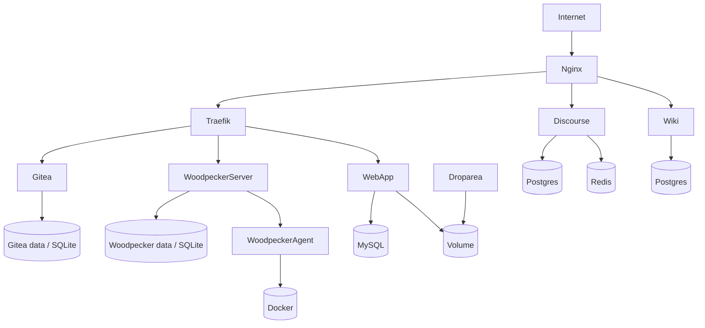

# Server


# TIC-80 Pipeline

This document describes the Woodpecker CI pipeline used to build, export, upload, and publish a TIC-80 game project.

---

## Overview

The pipeline performs the following steps:

1. **Build** the TIC-80 project using a custom Docker image
2. **Export** the game to `.tic` and HTML formats
3. **Upload artifacts** to a remote server via SCP
4. **Notify an update server** to publish the new version

The pipeline is driven by environment variables so it can be reused across projects.

---

## Global Environment

```yaml
environment: &environment
  GAME_NAME: mranderson
  GAME_LANG: lua
```

- **GAME_NAME**: Project name (used for all outputs)
- **GAME_LANG**: Source language used by TIC-80 (Lua)

The anchor (`&environment`) allows reuse across steps.

---

## Step 1: Build & Export

```yaml
- name: build
  image: git.teletype.hu/internal/tic80pro:latest
  environment:
    <<: *environment
    XDG_RUNTIME_DIR: /tmp
  commands:
    - make build
    - make export
```

**What it does:**

- Uses a custom TIC-80 Pro Docker image hosted in Gitea
- Runs the Makefile `build` target to assemble source files
- Runs the `export` target to generate:
  - `.tic` cartridge
  - `.html.zip` web build

---

## Step 2: Artifact Upload

```yaml
- name: artifact
  image: alpine
  environment:
    <<: *environment
    DROPAREA_HOST: vps.teletype.hu
    DROPAREA_PORT: 2223
    DROPAREA_TARGET_PATH: /home/drop
    DROPAREA_USER: drop
    DROPAREA_SSH_PASSWORD:
      from_secret: droparea_ssh_password
  commands:
    - apk add --no-cache openssh-client sshpass
    - mkdir -p /root/.ssh
    - sshpass -p $DROPAREA_SSH_PASSWORD scp -o StrictHostKeyChecking=no -P $DROPAREA_PORT \
        $GAME_NAME.$GAME_LANG \
        $GAME_NAME.tic \
        $GAME_NAME.html.zip \
        $DROPAREA_USER@$DROPAREA_HOST:$DROPAREA_TARGET_PATH
```

**What it does:**

- Installs SCP tooling in a minimal Alpine container
- Uploads:
  - Source file
  - TIC-80 cartridge
  - HTML export ZIP
- Uses secrets for SSH authentication

---

## Step 3: Update Notification

```yaml
- name: update
  image: alpine
  environment:
    <<: *environment
    UPDATE_SERVER: https://games.vps.teletype.hu
    UPDATE_SECRET:
      from_secret: update_secret_key
  commands:
    - apk add --no-cache curl
    - curl "$UPDATE_SERVER/update?secret=$UPDATE_SECRET&name=$GAME_NAME&platform=tic80"
```

**What it does:**

- Sends an HTTP request to the update server
- Notifies that a new TIC-80 build is available
- Uses a secret key to authorize the update

---

## Result

After a successful run:

- The game is built and exported
- Artifacts are uploaded to the server
- The public game index is updated automatically

This pipeline enables **fully automated TIC-80 releases** using open tools and infrastructure.


# TIC-80 Makefile Project Builder

This Makefile provides a simple, reproducible workflow for building **TIC-80 Lua projects** from multiple source files. It is designed for small indie or experimental projects where the source code is split into logical parts and then merged into a single `.lua` cartridge.

---

## Overview

The workflow is based on four core ideas:

- Source code is split into multiple Lua files inside an `inc/` directory
- A project-specific `.inc` file defines the **build order**
- All source files are concatenated into one final `.lua` file
- TIC-80 is used in CLI mode to export runnable artifacts

This approach keeps the codebase modular while remaining compatible with TIC-80’s single-file cartridge model.

---

## Project Structure

```text
project-root/
├── inc/
│   ├── core.lua
│   ├── player.lua
│   └── world.lua
├── mranderson.inc
├── Makefile
└── README.md
```

- `inc/` contains all Lua source fragments
- `<project>.inc` defines the order in which files are merged
- `<project>.lua` is generated automatically

---

## The `.inc` File

The `.inc` file is a **plain text file** listing Lua source files in build order:

```text
core.lua
player.lua
world.lua
```

The order matters. Files listed earlier are concatenated first and must define any globals used later.

---

## Usage

### Build (default)

```sh
make build
```

- Reads `mranderson.inc`
- Concatenates files from `inc/`
- Produces `mranderson.lua`

### Export (TIC-80)

```sh
make export
```

- Loads the generated Lua file into TIC-80 (CLI mode)
- Saves a `.tic` cartridge
- Exports an HTML build

### Export Assets

```sh
make export_assets
```

- **Purpose**: Extracts asset sections (PALETTE, TILES, SPRITES, MAP, SFX, MUSIC) from the compiled `<project>.lua` file.
- **Mechanism**: Uses `sed` to directly parse the generated `<project>.lua` and saves the extracted data into `inc/meta/meta.assets.lua`. This file can then be used to embed the asset data directly into other parts of the project or for version control of visual assets.

### Import Assets

The `import_assets` target was considered during development but is currently not part of the build workflow. Asset handling for TIC-80 projects within this Makefile relies solely on direct extraction (`export_assets`) from the built Lua cartridge, rather than importing external asset definitions. This target may be implemented in the future if a need for pre-build asset injection arises.

### Watch Mode

```sh
make watch
```

- Performs an initial build
- Watches the `inc/` directory and `.inc` file
- Rebuilds automatically on any change

Requires `fswatch` to be installed.

---

## Generated Artifacts

| File | Description |
|-----|-------------|
| `<project>.lua` | Merged Lua source (input for TIC-80) |
| `<project>.tic` | TIC-80 cartridge |
| `<project>.html` | Web export |
| `<project>.html.zip` | Packaged HTML build |

---

## Design Goals

- Keep TIC-80 projects modular
- Avoid manual copy-paste between files
- Enable fast iteration and experimentation
- Remain fully compatible with open-source tooling

This Makefile is intentionally minimal and transparent, favoring simplicity over abstraction.

---

## Requirements

- `make`
- `tic80` available in PATH
- `fswatch` (only for watch mode)

---

## License

MIT License — free to use, modify, and redistribute.


